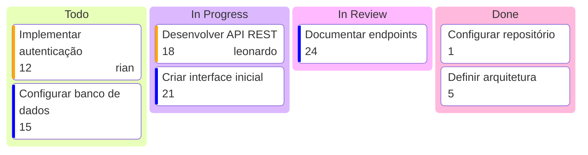

# Portfólio Interativo - Rian Dultra

Portfólio bilíngue (PT/EN) em Next.js com animações de scroll, conteúdo local em JSON/Markdown e formulário de contato por e-mail.

## Rodando localmente

```bash
npm install
npm run dev
```

Abra `http://localhost:3000`.

## Scripts

- `npm run dev`
- `npm run lint`
- `npm run typecheck`
- `npm run build`

## Conteúdo

- Config principal: `src/content/site.config.json`
- PT-BR: `src/content/pt-BR/*`
- EN: `src/content/en/*`

## Variáveis de ambiente

Copie `.env.example` para `.env.local` e preencha:

- `RESEND_API_KEY`
- `CONTACT_TO_EMAIL`
- `CONTACT_FROM_EMAIL`

## Foto de perfil

O projeto usa um placeholder em `public/images/profile-placeholder.svg`.
Para usar sua foto real, substitua o `src` da imagem em `src/components/sections/hero.tsx` para o arquivo final (ex.: `public/images/profile.png`).

## Deploy (Vercel)

1. Conectar repositório na Vercel.
2. Configurar variáveis de ambiente.
3. Deploy automático pela branch principal.


